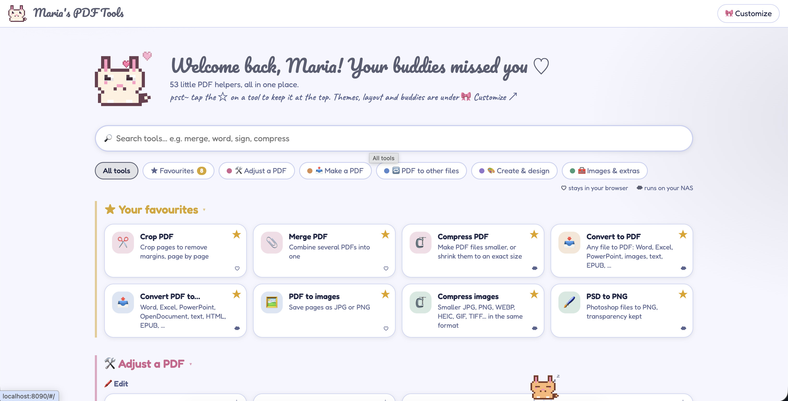
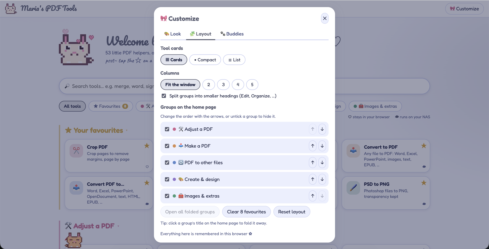
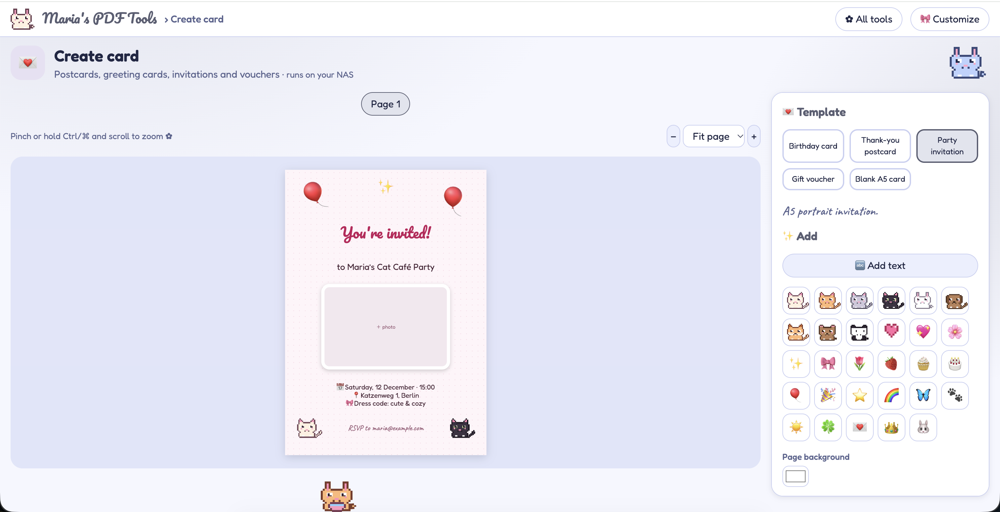

# Maria's PDF Tools ♡

A cute, self-hosted collection of PDF tools (inspired by PDF24). Pick a tool from the home page.
Light tools run entirely in the browser; heavy ones (Office conversions, OCR, compression, PDF/A,
encryption, redaction, …) run on the server inside the same container. Files are never sent anywhere else.

The home page groups the tools by what they do: **Make a PDF** (any file → PDF), **Adjust a PDF**
(PDF in, PDF out), **PDF to other files**, **Create & design** and **Images & extras**. Tap ☆ on a tool
to pin it to the top, click a group's title to fold it away, and hover a tool and press the crossed-out eye
to hide it (🙈 *Hidden* on the home page brings hidden tools back; Customize → Layout lists them all and has
an option to still find them when searching).

When a tool is done, *What next?* opens the result in another tool, with or without saving a copy first
(the crop tool has the same button next to *Save PDF*, and ↪ *Other tool* in the top bar does it for the
file you are working on). **Make it look scanned** turns photos (JPG, PNG, HEIC, WEBP, TIFF, …) and PDF
pages into a clean scanned PDF, like the Notes app: it finds the paper's edges, straightens it, removes
shadows and picks colour, grayscale or photo per page; corners, look and order can be changed per page. 🎀 *Customize* has colour themes,
light/dark mode, background patterns and colour, the home page layout (card style, columns, group
order and visibility) and the animal buddies (mascot, friends on/off, and 0–3 friends living along the bottom who wander
about and sit, nap, drink, eat, groom, play, stretch or chase butterflies — click one to say hi). Everything is remembered in the browser.



| Customize: home page layout | Create card |
| --- | --- |
|  |  |

## Run it

### On this computer

```sh
./scripts/run-local.sh
```

It builds the newest version, replaces the running container and starts it. Open <http://localhost:8090>.
Run it again after every change to the code.

The first build takes a while (LibreOffice, Tesseract OCR, Ghostscript and Chromium are installed); after
that, a change to `web/` or `server/` rebuilds in seconds. Everything works offline once built.

Or with compose: `docker compose up -d --build` (stop with `docker compose down`).

### On the NAS

1. On your computer, make the file for the NAS:
   ```sh
   ./scripts/build-nas-image.sh
   ```
   This creates `dist/maria-pdf-tools.tar`, built for the NAS's Intel/AMD processor.
   (A plain `docker build` on a Mac with an Apple chip makes an image the NAS can't run.)
2. Copy `dist/maria-pdf-tools.tar` to the NAS (into `dockerImages` in your home folder).
   `scripts/move-image-to-nas.sh` does this over the NAS's `home` share; it refuses a file that wasn't built for the NAS.
3. On the NAS (over SSH), load it and replace the container:
   ```sh
   cd dockerImages
   sudo docker load -i maria-pdf-tools.tar
   sudo docker rm -f maria-pdf-tools
   sudo docker run -d --name maria-pdf-tools --init --restart unless-stopped -p 8090:8080 -e MAX_UPLOAD_MB=300 --log-opt max-size=5m --log-opt max-file=2 maria-pdf-tools:latest
   ```
   `scripts/deploy-nas-container.sh` does this step from your computer.

   (`move-image-to-nas.sh` and `deploy-nas-container.sh` are kept out of git because they have the NAS address in them.)
4. Open `http://<nas-ip>:8090`.

Use SSH for `docker load`; importing the image in Container Manager can freeze a small NAS.

### Useful commands

- `docker ps` – running containers (`sudo docker ps` on the NAS)
- `docker logs maria-pdf-tools` – what the app printed (add `-f` to follow it)
- `docker image prune -f` – remove old images left over from updates

Settings in `docker-compose.yml`:
- `8090:8080` – change the left number to use a different port
- `MAX_UPLOAD_MB` – largest file the server accepts
- `HEAVY_JOBS`, `OCR_THREADS` (optional) – how many heavy conversions may run at once and how many
  threads OCR uses. Automatic: 1/1 on a NAS (or container limit) under 3 GB of RAM, else 2/2.
  `http://<nas>:8090/api/info` shows what was picked.
- `tmpfs /tmp:size=2g` – working files are kept in RAM; lower it on a NAS with little RAM.

Memory: idle ≈ 80–100 MB. While working, a job adds roughly: LibreOffice/Chromium 150 MB,
Ghostscript 15 MB, PDF → Word/Markdown 250–350 MB, OCR 370 MB (low-RAM mode) to 550 MB.
Jobs that need big libraries run in a short-lived helper process, so their memory is returned
as soon as they finish.

> There is no login. Keep it on your home network, or put it behind your NAS's VPN / reverse proxy with authentication.

## Project layout

```
web/            browser app (no build step)
  js/main.js    router + home page (filters, favourites, buddy settings)
  js/registry.js  list of tools, their categories and groups
  js/core.js    shared helpers (drop zones, options forms, results, zooming, API calls)
  js/editor.js  page viewer + editor used by View / Edit / Sign / Make fillable / Redact
  js/imagepdf.js  images → PDF pages (used by Convert to PDF)
  js/scanfx.js  page-edge detection, straightening and scanner clean-up (Make it look scanned)
  js/handoff.js the “open in another tool” picker
  js/prefs.js   preferences saved in the browser (favourites, look, layout, buddies)
  js/theme.js   colour themes, light/dark mode and backgrounds
  js/settings.js  the Customize dialog
  js/cats.js    the pixel-art animals
  js/pals.js    the friends living along the bottom of the window
  js/tools/     one module per tool
  vendor/       pdf.js, pdf-lib, fontkit, JSZip, Sortable, qrcode, fonts
server/         FastAPI app (main.py routes, convert.py, pdfops.py)
Dockerfile, docker-compose.yml
```

## Not finished yet

These have no screens yet, so they are not in `web/js/registry.js`; the server endpoint they
need (`/api/html-to-pdf`) already exists and is tested:
Write PDF, Create job application, Create invoice (form / visual).
